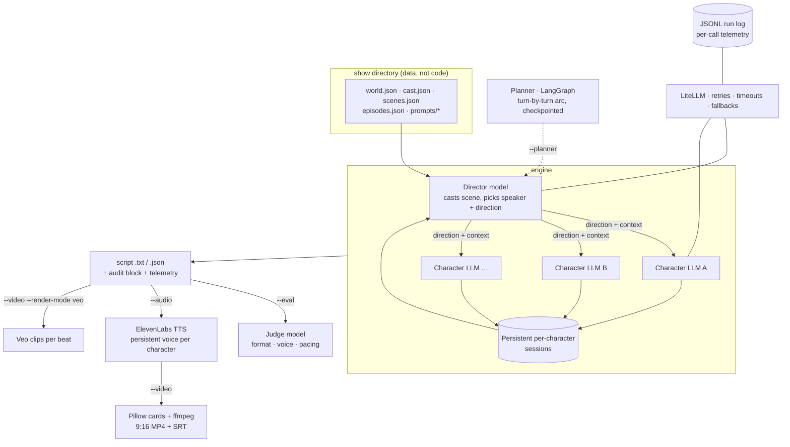

# Executive Producer

**A multi-provider LLM orchestration engine that generates scripted reality TV — where every cast
member is a different model, a director model runs the room, and a judge model grades the tape.**

A "Director" LLM decides who speaks next and why. Each character's dialogue is then generated by
*their own* LLM (different providers per character, on purpose — model personality bleeds through),
with persistent per-character memory that survives across scenes. Everything downstream is a
pipeline: judge-model evaluation, per-character TTS voices, 9:16 video assembly, and a LangGraph
pacing planner with checkpointed resume. The whole show — cast, world, scenes, prompts — is data,
not code.

```
🎬 Director: Rio → SHADE                       🎬 Director: Mara → DEFEND [simmer]
🎸 Rio: [balancing his chair on two legs]     ✨ Mara: [smoothing the receipt flat]
"We got somebody else's chaos order.          "It's called a system, Rio. You'd hate it
Feels like useful information."               for a week and then you'd never leave."
```

## Engineering highlights

- **One model-access layer.** Every text-model call from six providers goes through a single
  LiteLLM `call_model()` with config-driven retries, timeouts, and *opt-in* per-model fallbacks —
  configured for the director, deliberately not for cast (a silent provider swap would change a
  character's voice mid-scene).
- **Blast-radius thinking everywhere.** Director fails → random speaker pick. A character's API
  dies → stage-direction line, scene continues. TTS line fails → skipped, track still renders.
  Video explodes → script and audio already saved. Judge fails → no scorecard, never a crashed run.
- **Observability by default.** Every LLM/TTS/Veo call appends one JSONL record (caller, model,
  provider, latency, tokens, cost, fallback flag, error) — written per call, so a crashed run keeps
  its audit trail. A cost/token run summary prints after every run and is embedded in every output.
- **Auditability.** Every saved output carries an audit block: engine version, director/judge
  models, and a sha256 manifest of every config and prompt file loaded — any script traces back to
  the exact inputs that produced it.
- **Evaluation as an instrument, not a trophy.** A judge model (deliberately ≠ the director —
  the LLM-as-judge self-preference trap) scores format, voice, and pacing. When the planner landed,
  the eval loop's first real result was catching a defect in the planner's own prompt. That
  writeup is below, unvarnished.
- **A LangGraph planning layer with real checkpointing.** Graph state is deliberately all-JSON, so
  sqlite checkpoints make `--thread` resume an interrupted episode without re-billing completed
  turns. LangGraph orchestrates only this layer; LiteLLM stays the single model-access seam.
- **Media pipeline with explicit tradeoffs.** Persistent ElevenLabs voices + Pillow-composed video
  by default; Veo-native generation as a gated, priced-in opt-in. Text is drawn by Pillow
  specifically so minimal ffmpeg builds (no drawtext/libass) still work.
- **~140 unit tests, zero network.** All LLM/TTS/ffmpeg calls mocked; the suite runs in ~3 seconds.

## 60-second quickstart

```bash
git clone <repo> && cd exec-producer
uv sync                              # engine only; media/planner extras are opt-in
cp .env.example .env                 # 2+ provider keys, incl. the director's (starter: OpenAI)
uv run exec-producer --list          # scenes from the starter show (examples/sunset_terrace)
uv run exec-producer --scene rooftop_welcome --lines 6
```

That runs a real scene: the director casts it, four archetypes on four different providers
improvise it, and the script + raw JSON + telemetry land in `scripts/`.

## Architecture



The loop, per line of dialogue: the director reads the room and picks a speaker + direction →
context since that character last spoke is injected into their persistent session → *their* model
generates the line → repeat. Episodes keep sessions alive across scenes; characters remember.

## The pipeline

| Flag | Stage |
|---|---|
| `--eval` | Judge-model scorecard (format, voice, pacing) saved next to the script |
| `--audio` | Per-line TTS in each character's persistent voice, stitched per scene (`uv sync --extra audio`) |
| `--video` | 9:16 MP4: character cards + dialogue text + TTS audio; exact-timing SRT for editing (`--extra video`) |
| `--video --render-mode veo` | Real generated footage per beat via Veo — expensive, gated (`--extra veo`) |
| `--planner` | LangGraph pacing arc written before dialogue; `--thread <id>` resumes from checkpoint (`--extra planner`) |
| `--produce` | Copy-paste image/video prompts for manual production |
| `--director-only` | Full run with all dialogue redacted — demo the orchestration, not the content |
| `--data-dir` | Point the engine at any show directory ([CREATING_A_SHOW.md](CREATING_A_SHOW.md)) |

## Audio modes — the `--video` tradeoff

The video stage has two render modes, and the choice is a real production tradeoff, not a settings
knob:

### `tts` (default) — TTS-composited

Each character maps to a **persistent ElevenLabs voice ID** (`voices.json`). Every dialogue line
renders in that voice, lines are stitched per scene, and the video composes character cards over
the track.

- **Voice consistency is the whole point:** a character sounds identical in scene 1 and scene 40 —
  across episodes, across re-renders, forever.
- **Editable:** per-line mp3s, per-line card PNGs, and an exact-timing SRT are all kept next to the
  final MP4 — re-record one line and restitch, or drop the pieces straight into an editor.
- **Cheap:** TTS bills per character; a full scene costs cents.

### `veo` (`--render-mode veo`) — Veo-native

Real generated footage: each production beat (2–3 dialogue lines) becomes a Veo clip, with the
dialogue spoken by Veo's native audio, clips concatenated per scene. Gated behind its own flag, its
own API key (`GEMINI_API_KEY`), and its own optional dependency — never a default.

- **Real footage** instead of name cards — this is the "looks like TV" mode.
- **Voices drift:** Veo cannot hold a character's voice across clips. The same character sounds
  different from beat to beat — acceptable for a one-off clip, wrong for a series.
- **Expensive:** video generation bills per second of output; a scene costs dollars, not cents.

The engine treats the tradeoff explicitly: persistent identity + auditability + cost by default,
native footage as a deliberate opt-in.

## Evaluation, and what the planner experiment actually showed

The documented failure mode of per-turn directing is myopia: unplanned scenes can escalate
instantly, with zero filler. The `--planner` stage attacks it — a planner node writes the scene's
turn-by-turn emotional arc *before* any dialogue, and every director call gets its turn's plan
entry with "pace to the plan."

The honest first results, from paired same-scene runs scored by the judge:

| Condition | Baseline pacing | Planned pacing |
|---|---|---|
| low intensity, 8 lines | 7/10 | 7/10 |
| high intensity, 12 lines | 8/10 | 6/10 |

No win — and the loss taught something. The judge's note on the planned high-intensity run: the
plan's "cooldown" ending made a character *summarize the scene* — "late season should end on a raw,
unresolved explosion, not a neat analytical bow." That was a defect in the planner's prompt (it
allowed cooldown endings regardless of intensity), fixed the same day, found by the eval loop on
its first outing. Two samples are noise, not a verdict; the instrument, the baseline, and the
regression story are the point. This is what evaluation infrastructure is *for*.

## Guardrails

Generated scripts can be R-rated by design (intensity is a per-show dial) — the guardrails exist so
the engine can still be run, demoed, and audited safely.

### `--director-only` — redacted output for sharing

Runs the full simulation but redacts every dialogue line to `████` bars on the console, showing
only the director's decisions: who speaks, the direction they're given (RESPOND_TO, SHADE,
DEFEND...), and stage directions, followed by a Decision Flow summary. The result demonstrates the
orchestration engine — the interesting part — with zero risk of content appearing in a screenshot
or screen share. The `--eval` judge composes with this: console output is scores only.

### Content-rating gate — capped intensity for public runs

Set a hard cap in `world.json` that wins over whatever any episode config or CLI flag requests
(the starter show ships capped):

```json
"content_rating": { "max_intensity": "medium" }
```

Every run prints a notice when the cap engages, so a capped run is visibly capped.

### Audit trail — every run is reproducible and inspectable

Every run produces, without any flags:

- **`scripts/run_<ts>_<pid>_calls.jsonl`** — one record per LLM/TTS/Veo call, appended per call so
  even a crashed run keeps its trail; the first line is a `run_start` header with the audit block.
- **An `audit` block** in every saved output — engine version, director/judge models, and a sha256
  manifest of every config and prompt file loaded.
- **The full director decision log** — every speaker choice, direction, and stage direction.

## Creating your own show

A show is a directory of JSON + prompt files — no Python. Copy the starter, edit, point the engine
at it:

```bash
cp -r examples/sunset_terrace my_show
uv run exec-producer --data-dir my_show --scene rooftop_welcome --lines 6
```

The full data contract (and what every file does) is in
[CREATING_A_SHOW.md](CREATING_A_SHOW.md). An incomplete show directory fails fast with a list of
everything missing.

## Docker

```bash
docker build -t exec-producer .
docker run --env-file .env exec-producer --scene rooftop_welcome --lines 6
docker run --env-file .env -v ./my_show:/show exec-producer --data-dir /show --list
```

The image bundles ffmpeg + fonts (full media pipeline) and ships only the starter show.

## Development

```bash
uv run pytest        # ~140 tests, all LLM/TTS/ffmpeg calls mocked, no network
uv sync --all-extras # audio + video + veo + planner extras
```

Notable pins: `litellm >=1.83,<1.92` (1.92 drops pure-Python wheels; the cap keeps Python 3.14
viable everywhere, including the Docker image).

## License

[MIT](LICENSE)
