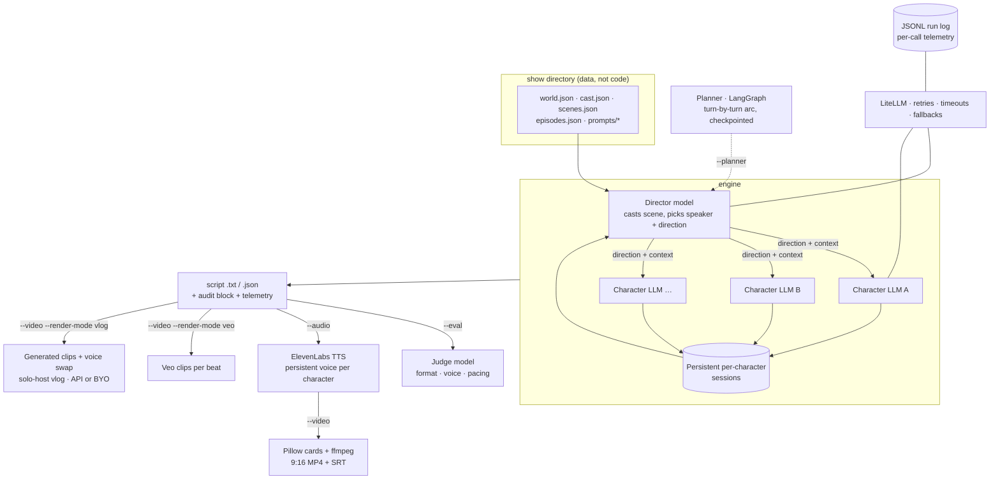

# Executive Producer

**A multi-provider LLM orchestration engine that generates scripted reality TV — where every cast
member is a different model, a director model runs the room, and a judge model grades the tape.**

A "Director" LLM decides who speaks next and why. Each character's dialogue is then generated by
*their own* LLM (different providers per character, on purpose — model personality bleeds through),
with persistent per-character memory that survives across scenes. Everything downstream is a
pipeline: judge-model evaluation, per-character TTS voices, 9:16 video assembly, and a LangGraph
pacing planner with checkpointed resume. The whole show — cast, world, scenes, prompts — is data,
not code.

```
🎬 Director: Rio → SHADE                       🎬 Director: Mara → DEFEND [simmer]
🎸 Rio: [balancing his chair on two legs]     ✨ Mara: [smoothing the receipt flat]
"We got somebody else's chaos order.          "It's called a system, Rio. You'd hate it
Feels like useful information."               for a week and then you'd never leave."
```

## Engineering highlights

- **One model-access layer.** Every text-model call from six providers goes through a single
  LiteLLM `call_model()` with config-driven retries, timeouts, and *opt-in* per-model fallbacks —
  configured for the director, deliberately not for cast (a silent provider swap would change a
  character's voice mid-scene).
- **Blast-radius thinking everywhere.** Director fails → random speaker pick. A character's API
  dies → stage-direction line, scene continues. TTS line fails → skipped, track still renders.
  Video explodes → script and audio already saved. Judge fails → no scorecard, never a crashed run.
- **Observability by default.** Every LLM/TTS/Veo call appends one JSONL record (caller, model,
  provider, latency, tokens, cost, fallback flag, error) — written per call, so a crashed run keeps
  its audit trail. A cost/token run summary prints after every run and is embedded in every output.
- **Auditability.** Every saved output carries an audit block: engine version, director/judge
  models, and a sha256 manifest of every config and prompt file loaded — any script traces back to
  the exact inputs that produced it.
- **Evaluation as an instrument, not a trophy.** A judge model (deliberately ≠ the director —
  the LLM-as-judge self-preference trap) scores format, voice, and pacing. When the planner landed,
  the eval loop's first real result was catching a defect in the planner's own prompt. That
  writeup is below, unvarnished.
- **A LangGraph planning layer with real checkpointing.** Graph state is deliberately all-JSON, so
  sqlite checkpoints make `--thread` resume an interrupted episode without re-billing completed
  turns. LangGraph orchestrates only this layer; LiteLLM stays the single model-access seam.
- **Media pipeline with explicit tradeoffs.** Persistent ElevenLabs voices + Pillow-composed video
  by default; Veo-native generation as a gated, priced-in opt-in. Text is drawn by Pillow
  specifically so minimal ffmpeg builds (no drawtext/libass) still work.
- **Zero-network test suite.** Every LLM/TTS/ffmpeg call is mocked; it runs in seconds and needs no API keys.

## 60-second quickstart

```bash
git clone <repo> && cd exec-producer
uv sync                              # engine only; media/planner extras are opt-in
cp .env.example .env                 # 2+ provider keys, incl. the director's (starter: OpenAI)
uv run exec-producer doctor          # what's configured, what's ready, what's missing
uv run exec-producer --list          # scenes from the starter show (examples/sunset_terrace)
uv run exec-producer --scene rooftop_welcome --lines 6
uv run exec-producer --episode premiere   # full episode — sessions persist across scenes
```

That runs a real scene: the director casts it, four archetypes on four different providers
improvise it, and the script + raw JSON + telemetry land in `scripts/`. `--list-episodes`
shows the episodes a show ships; an episode run keeps every character's memory alive from
scene to scene, and the director casts each scene after the opener.

### `exec-producer doctor`

Everything that has to be true before a run costs money, checked in one command without
starting one: which show is loaded, which guardrails are active, whether the director/judge/cast
keys resolve, and whether each optional stage (`--audio`, `--video`, `--render-mode veo|vlog`,
`--planner`) has its keys, binaries, extras, and voice coverage.

```bash
uv run exec-producer doctor          # human-readable report
uv run exec-producer doctor --json   # same report, machine-readable
```

A missing optional extra is a warning, not a failure — the core engine runs fine without
Pillow. Exit codes: **0** healthy, **1** a core check failed, **2** a check couldn't run at all
(which is a different problem than "the answer is no").

One class of problem doesn't reach the report: the show directory is loaded at import, before any
command runs, so a contract violation is reported there instead. Missing files are listed
legibly; malformed JSON or a missing required `world.json` key still surfaces as a raw traceback.

## Architecture



The loop, per line of dialogue: the director reads the room and picks a speaker + direction →
context since that character last spoke is injected into their persistent session → *their* model
generates the line → repeat. Episodes keep sessions alive across scenes; characters remember.

## The pipeline

| Flag | Stage |
|---|---|
| `--episode <id>` | Full episode run — persistent sessions across scenes, per-scene casting, plot beats (`--list-episodes` to enumerate) |
| `--eval` | Judge-model scorecard (format, voice, pacing) saved next to the script |
| `--audio` | Per-line TTS in each character's persistent voice, stitched per scene (`uv sync --extra audio`) |
| `--video` | 9:16 MP4: character cards + dialogue text + TTS audio; exact-timing SRT for editing (`--extra video`) |
| `--video --render-mode veo` | Real generated footage per beat via Veo — expensive, gated (`--extra veo`) |
| `--video --render-mode vlog` | Solo-host generated footage + speech-to-speech voice swap; `--dry-run` cost preview, `--clips-dir` for externally-generated clips (`--extra vlog`) |
| `--planner` | LangGraph pacing arc written before dialogue; `--thread <id>` resumes from checkpoint (`--extra planner`) |
| `--produce` | Copy-paste image/video prompts for manual production |
| `--director-only` | Full run with all dialogue redacted — demo the orchestration, not the content |
| `--data-dir` | Point the engine at any show directory ([CREATING_A_SHOW.md](CREATING_A_SHOW.md)) |
| `--solo` | Run one cast member from a bigger show (one cast key + the director key). One-character shows are solo automatically |
| `render <file>` / `--from-script` | Render an externally-written scene .json through the downstream stages only — no generation calls, audit stamped `generator: external` |

## Bring your own script

`exec-producer render <scene.json>` accepts a scene in the engine's own saved-JSON shape and
runs ONLY the downstream stages — .txt formatting, `--eval`, `--audio`, `--video`, `--produce`.
Validation is hard and happens before any TTS/video spend; the audit block records
`generator: "external"` with generation cost unknown (the TTS-cost precedent). No director key
needed (except `--produce`, which bills the director model).

The intended workflow ships as a committed Claude Code skill
([.claude/skills/showrunner/SKILL.md](.claude/skills/showrunner/SKILL.md)): describe an episode
idea in a session, the session writes the scene JSONs on your subscription — zero generation API
spend — self-reviews them against the show's eval rubric, renders each scene, and emits YouTube
packaging (titles, thumbnail prompt, description, hook). The JSON contract is documented in the
skill, so any agent harness can produce render-ready scenes. LiteLLM remains the engine's single
model-access layer — the decoupling is the file contract, not a wired-in provider.

## Audio modes — the `--video` tradeoff

The video stage has three render modes, and the choice is a real production tradeoff, not a
settings knob:

### `tts` (default) — TTS-composited

Each character maps to a **persistent ElevenLabs voice ID** (`voices.json`). Every dialogue line
renders in that voice, lines are stitched per scene, and the video composes character cards over
the track.

- **Voice consistency is the whole point:** a character sounds identical in scene 1 and scene 40 —
  across episodes, across re-renders, forever.
- **Editable:** per-line mp3s, per-line card PNGs, and an exact-timing SRT are all kept next to the
  final MP4 — re-record one line and restitch, or drop the pieces straight into an editor.
- **Cheap:** TTS bills per character; a full scene costs cents.

### `veo` (`--render-mode veo`) — Veo-native

Real generated footage: each production beat (2–3 dialogue lines) becomes a Veo clip, with the
dialogue spoken by Veo's native audio, clips concatenated per scene. Gated behind its own flag, its
own API key (`GEMINI_API_KEY`), and its own optional dependency — never a default.

- **Real footage** instead of name cards — this is the "looks like TV" mode.
- **Voices drift:** Veo cannot hold a character's voice across clips. The same character sounds
  different from beat to beat — acceptable for a one-off clip, wrong for a series.
- **Expensive:** video generation bills per second of output; a scene costs dollars, not cents.

### `vlog` (`--render-mode vlog`) — generated footage with a persistent voice

The third mode resolves the tradeoff for solo-host shows by combining the other two: **real
generated footage AND a consistent voice**, via a speech-to-speech voice swap.

- **Everything on screen is generated video** — selfie-vlog POV of the host mixed with cinematic
  b-roll, moving camera, ambient life. No stills, no name cards, ever, in this mode.
- **Per-line delivery markers** in the scene JSON (`"delivery": "on_camera" | "voiceover"`)
  control *audio* treatment only — every beat becomes a full clip either way:
  - *on_camera*: the clip is generated with the host speaking the line (reference images +
    quoted dialogue in the prompt). The clip's audio is extracted, run through **ElevenLabs
    speech-to-speech** into the host's persistent voice (`voices.json`), and remuxed. Same words +
    same timing keeps the lips plausibly synced — and the host sounds identical in every clip of
    every episode.
  - *voiceover*: the clip generates with ambient sound only; the line renders via the TTS stage
    and is mixed over the clip with the ambient bed ducked underneath.
- **Host visual consistency** comes from reference images (`visuals.json` →
  `characters.<id>.reference_images`, up to 3) attached to every generation with the host in
  frame. API constraint (verified July 2026): reference images force 8-second clips and reject
  9:16 output — a 9:16 show generates those beats at 16:9 with a centered-subject prompt and
  center-crops in post. 16:9, the native YouTube vlog format, is the default.
- **Three ways to get the clips**, one downstream pipeline (voice swap, voiceover mix, assembly,
  exact-timing SRT — identical regardless of where the pixels came from):

  | Route | How | Cost profile |
  |---|---|---|
  | Veo API | automated per-beat generation, polled, telemetry-receipted | bills per second — dominates every other cost |
  | Veo web UI | `--dry-run` emits a per-beat prompt pack; generate on your subscription quota, drop files in a folder, render with `--clips-dir` | no API cost; manual; possible watermark |
  | any other tool | same prompt pack, same beat-numbered folder contract | whatever the tool costs |

- **Cost controls are mandatory, not optional:** `--dry-run` prints the clip plan (count,
  durations, on-camera/voiceover split) and an ESTIMATED cost (configurable
  `vlog.price_per_second` in `visuals.json`) before anything generates; `vlog.max_clips` caps the
  API route per run with a clear error; every Veo call and voice-swap call lands in the JSONL
  telemetry.

> **Disclosure note:** YouTube requires creators to disclose realistic altered or synthetic
> content — a photorealistic synthetic host qualifies. Tick the disclosure box when uploading.

The engine treats the tradeoff explicitly: persistent identity + auditability + cost by default,
native footage as a deliberate opt-in, and the vlog mode as the composition of both for solo
shows.

## Evaluation, and what the planner experiment actually showed

The documented failure mode of per-turn directing is myopia: unplanned scenes can escalate
instantly, with zero filler. The `--planner` stage attacks it — a planner node writes the scene's
turn-by-turn emotional arc *before* any dialogue, and every director call gets its turn's plan
entry with "pace to the plan."

The honest first results, from paired same-scene runs scored by the judge:

| Condition | Baseline pacing | Planned pacing |
|---|---|---|
| low intensity, 8 lines | 7/10 | 7/10 |
| high intensity, 12 lines | 8/10 | 6/10 |

No win — and the loss taught something. The judge's note on the planned high-intensity run: the
plan's "cooldown" ending made a character *summarize the scene* — "late season should end on a raw,
unresolved explosion, not a neat analytical bow." That was a defect in the planner's prompt (it
allowed cooldown endings regardless of intensity), fixed the same day, found by the eval loop on
its first outing. Two samples are noise, not a verdict; the instrument, the baseline, and the
regression story are the point. This is what evaluation infrastructure is *for*.

## Guardrails

Generated scripts can be R-rated by design (intensity is a per-show dial) — the guardrails exist so
the engine can still be run, demoed, and audited safely.

### `--director-only` — redacted output for sharing

Runs the full simulation but redacts every dialogue line to `████` bars on the console, showing
only the director's decisions: who speaks, the direction they're given (RESPOND_TO, SHADE,
DEFEND...), and stage directions, followed by a Decision Flow summary. The result demonstrates the
orchestration engine — the interesting part — with zero risk of content appearing in a screenshot
or screen share. The `--eval` judge composes with this: console output is scores only.

### Content-rating gate — capped intensity for public runs

Set a hard cap in `world.json` that wins over whatever any episode config or CLI flag requests
(the starter show ships capped):

```json
"content_rating": { "max_intensity": "medium" }
```

Every run prints a notice when the cap engages, so a capped run is visibly capped.

### Budget gate — a run that stops before the bill does

The money-shaped sibling of the content-rating cap. Set a ceiling in `world.json`:

```json
"budget": { "max_run_usd": 2.50 }
```

The generation loops — classic, episode, and the `--planner` graph — check the run's recorded
spend between turns. Once it reaches the cap they stop generating and save everything produced
so far, so a runaway episode costs you a scene, not a script.

The media stages are gated too: a capped run won't go on to bill ElevenLabs for every line it
already produced, or Veo for every beat. The judge and production-prompt stages still run (each
bounded at three attempts per scene), so a capped run still yields its usual artifacts.

Two limits worth knowing before you rely on it:

- **It's a stop-line, not a ceiling.** A call's cost isn't knowable until it returns, so a run
  overshoots by whatever was in flight — up to four billed calls in the classic loop, since a
  turn is a director call plus a character call and each retries up to three times on malformed
  JSON.
- **It can't see media spend.** ElevenLabs bills per plan tier and the Veo API reports no
  per-operation price, so those calls record cost as *unknown*, which counts as zero. The gate
  stops the media stages once text generation trips it, but a mostly-video run can exceed the cap
  without the cap noticing. For those runs the real controls are `vlog.max_clips`, `--dry-run`,
  and `--clips-dir`.

`"max_run_usd": 0` means *spend nothing*, not *no limit*; remove the key entirely for no cap. A
non-numeric or negative value is rejected when the show loads, rather than at the first turn
boundary after the run has already billed.

### Secret redaction — logs you can paste into an issue

Everything reaching the package logger passes through a redacting formatter that masks
vendor-prefixed API keys, `KEY=value` assignments, JSON credential fields, and bearer tokens.
Long secrets keep a first-6/last-4 stub so "which key was that?" stays answerable; short ones are
masked whole.

This is defense in depth rather than a fix for a known leak — none of the supported providers
currently echo a rejected key back in their error text, but that's their choice to change, not
ours. It's deliberately conservative in the other direction too: a bare, prefix-less key in free
prose will slip through, because a redactor that eats the error message destroys the diagnostic
the line exists to deliver. Console `print()` output and the JSONL run log don't pass through the
formatter; see [SECURITY.md](SECURITY.md) for what covers them.

### Audit trail — every run is reproducible and inspectable

Every run produces, without any flags:

- **`scripts/run_<ts>_<pid>_calls.jsonl`** — one record per LLM/TTS/Veo call, appended per call so
  even a crashed run keeps its trail; the first line is a `run_start` header with the audit block.
- **An `audit` block** in every saved output — engine version, director/judge models, and a sha256
  manifest of every config and prompt file loaded.
- **The full director decision log** — every speaker choice, direction, and stage direction.

## Creating your own show

A show is a directory of JSON + prompt files — no Python. Two starters are committed, one per
format — copy whichever matches, edit, point the engine at it:

- **`examples/sunset_terrace`** — a four-person ensemble (the classic director-casts-a-house format)
- **`examples/night_signal`** — a one-character solo show (an overnight radio host; the director
  loop degenerates to beat direction + pacing, and a single cast key + the director key suffice)

```bash
cp -r examples/sunset_terrace my_show
uv run exec-producer --data-dir my_show --scene rooftop_welcome --lines 6
uv run exec-producer --data-dir examples/night_signal --scene sign_on --lines 4
```

The full data contract (and what every file does) is in
[CREATING_A_SHOW.md](CREATING_A_SHOW.md). An incomplete show directory fails fast with a list of
everything missing.

## Docker

```bash
docker build -t exec-producer .
docker run --env-file .env exec-producer --scene rooftop_welcome --lines 6
docker run --env-file .env -v ./my_show:/show exec-producer --data-dir /show --list
```

The image bundles ffmpeg + fonts (full media pipeline) and ships only the starter show.

## Development

```bash
uv run pytest        # all LLM/TTS/ffmpeg calls mocked, no network, no keys
uv sync --all-extras # audio + video + veo + vlog + planner extras
```

CI runs the suite, a starter-show load check, a `doctor` contract assertion, the pre-commit
hooks (actionlint + zizmor), and a `uv lock --check` gate on every push and PR. Contributor and
agent-facing house rules are in [AGENTS.md](AGENTS.md); security posture and reporting are in
[SECURITY.md](SECURITY.md).

Notable pins: `litellm >=1.83,<1.92` (1.92 drops pure-Python wheels; the cap keeps Python 3.14
viable everywhere, including the Docker image).

## License

[MIT](LICENSE)
